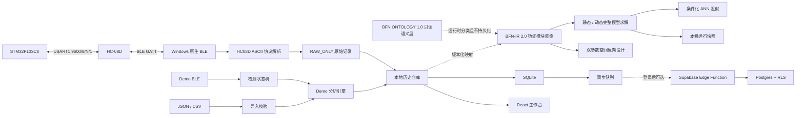
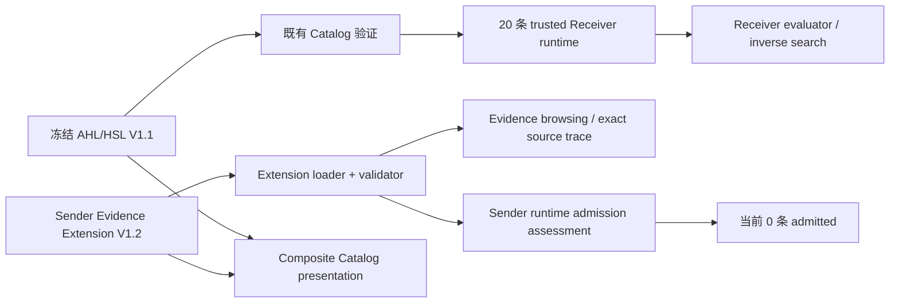

# Windows 桌面端架构

## 系统目标

桌面端承担四条彼此边界清楚的本地优先工作流：

1. Windows 通过 BLE 直接连接 HC-08D，显示并保存真实四路原始光强。
2. Demo 传输生成模拟曲线，执行演示分析并形成带 Demo 标记的结果。
3. 导入 JSON 或 CSV，完成格式校验和离线分析。
4. BIO-NET 使用 BFN-IR 2.0 组织完整功能模块、静态/动态仿真、条件化 ANN 近似和双参数空间反向设计；检测记录与功能网络保持独立的数据边界。

云端仅负责可选账号、团队工作区和记录同步，不进入设备采集关键路径。

## 数据流



真实运行路径为：

```text
Windows 应用 ↔ BLE ↔ HC-08D ↔ UART ↔ STM32 ↔ I²C ↔ AS7341
```

手机和电脑均为 BLE Central。HC-08D 联调时只保留一个 Central 连接，电脑测试前先断开手机及其他电脑。

## 分层

### 表现层

`src/pages`、`src/components` 和 `src/app` 负责布局、交互、图表和导航。固定导航为概览、采集、网络建模、分析、记录和设置；团队工作区从设置进入。

真实设备和 Demo 共用采集页：

- 演示设备显示三通道校正信号、调零和校准；模拟故障收纳在可展开的“演示场景”中。
- HC-08D 显示 480、515、555 nm 与 CLR 原始值、饱和标记、检测光源控制和本机记录。
- UUID、候选特征和最近原始行位于可展开技术详情中。

页面只调用 Zustand action，不直接访问 `btleplug`、Tauri 命令、SQLite 或云端管理接口。

### 应用状态层

`src/store/appStore.ts` 管理页面、传输模式、连接状态、检测状态、采样数据、硬件帧、诊断信息、结果和历史列表。`createAppStore` 接受可注入传输实例，便于对真实行为进行隔离测试。

`SwitchableBleTransport` 在 `demo` 与 `hc08d` 之间切换。切换时依次断开、释放旧传输、创建新传输并清理当前会话。用户选择保存在本机。

真实固件持续约每 0.5 秒发送一帧。“开始记录”和“结束并保存”是本机边界，不发送固件未定义的 START/STOP。真实模式中的 ZERO/CALIBRATE 被明确禁用。

### BLE 传输层

`BleTransport` 定义扫描、停止扫描、连接、断开、命令、订阅、连接状态和资源释放接口。

- `MockBleTransport`：Demo 扫描、连接、三通道采样与故障场景。
- `Hc08dBleTransport`：协议缓冲、命令应答、诊断、数据陈旧检测和重连调度。
- `tauriBleApi`：TypeScript 与 Rust Tauri 命令、事件之间的边界。
- `SwitchableBleTransport`：模式切换、订阅转发和能力分派。

Rust 端 `src-tauri/src/hc08d` 使用 `btleplug` 完成 Windows 扫描、连接、GATT 发现、Notify/Indicate 订阅和 Write。扫描结果向界面暴露会话内不透明 ID，不把完整 MAC 地址写入仓库。

连接后的特征选择顺序：

1. 优先识别 FFE0 服务与 FFE1 特征，包括完整 Bluetooth Base UUID 表示。
2. 检查同一服务内唯一的 Notify/Indicate 与 Write 组合。
3. 若只有一个双向特征，允许同一特征承担通知和写入。
4. 存在多个等价组合时拒绝猜测，并返回候选项供用户手动选择。

### 协议层

`Hc08dProtocolParser` 解析 `HC08D-ASCII-DRAFT-0.2`：

```text
480:<uint16>,515:<uint16>,555:<uint16>,CLR:<uint16>\r\n
```

解析器支持跨 BLE 通知分片、单次通知多行、相邻帧兜底分界、UTF-8 校验、缓冲上限和协议错误恢复。BLE 通知仅作为字节块处理，未出现 LF 或下一段 `480:` 时不会按时间间隔提前提交。每个有效帧附加应用侧序号、接收时间和相对时间。`65535` 标记为数字饱和，数值继续保留。

LED 命令使用单一在途请求：BLE 写入后状态为 `accepted`，收到匹配的 `LED_ON_OK` 或 `LED_OFF_OK` 后状态为 `completed`。`ERROR_COMMAND`、不匹配响应和 2 秒无响应均不会显示为成功。

### 分析层

`features/analysis` 包含无 UI、无存储副作用的输入校验和纯函数。当前 Demo/导入流程包括：

- 原始值和背景值校验
- `max(0, raw - background)` 背景校正
- 尾部窗口中位数摘要
- Demo 线性换算
- Demo 质量模型
- 版本与免责声明写入结果

真实 HC-08D 数据不进入该流程。真实记录的 `algorithmVersion` 与 `calibrationVersion` 为 `null`，结果状态为 `RAW_ONLY`。

### 建模层

默认建模路径位于 `features/bfn`，使用 `BFN-IR 2.0`。网络对象包括 `InputSource`、`FunctionalModule`、`IdealEdge` 和 `OutputMonitor`。端口使用 `P=(E,Q,U)` 保存实体、量类型和单位。连接层只验证端口语义并执行单位换算；理想边固定为 identity，不保存权重、偏置、增益、延迟、噪声或状态。

功能模块保存完整静态或动态响应、参数区间、上下文、适用域、数据来源、证据等级、模型版本和生物实现。静态引擎支持固定值、工作域扫描、多输入组合、Hill、线性、identity 和独立作用模型；动态引擎当前支持一阶响应、恒定/阶跃/脉冲/周期/自定义输入和静态无记忆模块。两条路径都传播演示参数区间并标记域外外推。

`features/modeling/ontology/v1` 提供独立 BFN-ONTOLOGY-1.0 语义覆盖层。Functional Family、Biological Component Family、Mathematical Model Family 与 Runtime / Evidence Capability 是四个独立维度。Catalog 对象只从可信 presentation 的精确 Component ID 与 canonical role 分类；内置模块只从稳定 label key 的精确软件映射分类。未知模块返回两个显式 unclassified term，名称、别名、模型族和 static/dynamic 模式不触发推断。

Ontology registry、term 与 assignment 深冻结并执行 manifest、唯一性、父级、环、顺序和覆盖校验。Resolver 只读取 BFN module identity，返回深冻结 semantic profile，不调用求值器、仿真或实例化逻辑。分类不改变端口兼容、运行资格、Catalog trust、证据等级、Add eligibility 或构建状态。

`features/bfn/temporal` 与 `features/bfn/compatibility` 构成 BFN-IR 外的 derived read-only contract layer。Temporal resolver 复用唯一的 effective-model selection，命名 steady-state、quasi-static、stateful dynamic 与 unsupported，并将执行方式与 T0–T3 / not-recorded 时间证据分离。Compatibility assessment 复用既有单位量纲定义，独立评估端口硬边界与 Host、Strain、Medium、Temperature 的实验适用性。核心 resolver/assessment 不写 Project、Run、Workspace 或 schema，不调用 Simulation、Catalog verification、Instantiation 或 Ontology 推断来改变运行资格。仿真编排层在成功运行后复制输出可达模块与模块边的 assessment，形成可选的 BFN-SIM 2.0 时间和上下文 provenance；历史展示只读快照，不从当前 Project 回算。

Sender V1.2 位于独立的 evidence extension 层。它与冻结 Receiver runtime 的关系为：



`features/modeling/catalog/sender/v1_2` 保存源文件、无损 evidence types、CSV/JSON loader、发布与引用校验、展示范围和 runtime admission。`features/bfn/catalog` 只把验证后的扩展投影为 Catalog Search、Preview 与 Full Detail。Composite presentation 不成为 runtime authority；V1.2 presence 不改变 20 条 Receiver whitelist，0-admitted Sender 不生成 Module、Add 操作、Evaluator、自动连线或 inverse candidate。完整合同见 [Sender Evidence Extension V1.2](sender-evidence-v1.2.md)。

`ANNApproximation` 只在静态工作域存在时拟合。它保存有效权重、有效截距、R²、NRMSE、最大绝对误差、覆盖率以及 accepted/rejected 状态。固定点不生成 ANN 参数；近似被拒绝时继续使用完整非线性模型。

反向设计把功能参数 `θ` 与生物设计变量 `q` 分离，通过版本化校准映射计算候选完整响应，并综合评价功能误差、宿主负载、串扰、噪声、不确定性和遗传稳定性。结果是带 `proposed_unbuilt_design` 证据等级和验证建议的候选集合，不是一个无解释的最优答案。

原 `features/modeling`、V1.1 AHL/HSL 目录、检测记录映射和旧项目迁移器继续保留，用于历史文件诊断、来源追溯和显式迁移。V2 不会把旧版 `baseline / gain / sensitivity` 自动改名为完整响应模型，也不从荧光检测记录推断功能网络。

### 持久化层

Tauri 环境使用 `sqlite:fluorescence.db`，迁移位于 `src-tauri/migrations`。主要数据表：

- `detection_records`：记录元数据与版本化结果 JSON
- `channel_samples`：Demo/导入分析通道采样
- `hc08d_frames`：真实 480、515、555、CLR、饱和位图和原始文本行
- `sync_queue`：待同步操作
- `app_settings`、`workspace_cache`：设置与工作区缓存

浏览器开发模式使用 localStorage 回退，使界面和状态测试不依赖原生插件。该回退不用于生产数据库能力评价。

BFN-IR 2.0 项目和运行快照分别使用 `fluorescence-desktop.bfn-ir-project.v2` 与 `fluorescence-desktop.bfn-ir-runs.v2`。运行记录继续声明 `BFN-SIM-2.0`，时间执行和上下文适用性快照为可选字段；没有这些字段的历史运行继续读取。旧建模键保持原样，V2 导入只接受 `schema: BFN-IR` 与 `schemaVersion: 2.0`。这些数据独立于检测 SQLite 表；BIO-NET 不复制原始帧，也不把检测结果自动解释为网络输入。

BFN-ONTOLOGY-1.0 是随应用发布的版本化只读 registry，不写 localStorage、IndexedDB、BFN Project、Version 或 Run。Workspace IndexedDB schema 继续保持 v1。

### 云端层

客户端使用 Supabase anon key 和用户会话。刷新令牌通过 Rust keyring 命令写入 Windows Credential Manager。服务端角色密钥只存在于 Edge Functions 环境。云端表以 RLS 和 `workspace_id + idempotency_key` 控制访问与幂等。

## 状态与恢复

主要检测路径：

```text
idle -> scanning -> idle -> connecting -> ready
ready -> running -> stopping -> finished / incomplete
任意活动状态 -> disconnected / error
```

Demo 允许 `ready -> zeroing/calibrating -> ready`。HC-08D 当前固件不支持这两个动作。

意外断线触发约 1、2、4 秒三次重连。显式断开、模式切换或运行时释放会取消所有重连、陈旧数据计时器、命令超时和通知订阅。连接代次用于丢弃旧事件。

## 国际化、可访问性与边界

- `zh-CN` 与 `en-US` 的翻译键结构保持一致。
- 状态使用文字、图标和颜色共同表达；饱和点在 SVG 外提供文字说明。
- 技术错误、UUID 和原始行按需展开，普通流程不直接暴露工程术语。
- 界面支持减少动态效果和减少透明度偏好。
- 真实硬件配置集中在协议与传输模块，不在页面硬编码最终 UUID。
- 真实信号单位、背景模型、标定、浓度换算和质量阈值均等待版本化科学输入。
