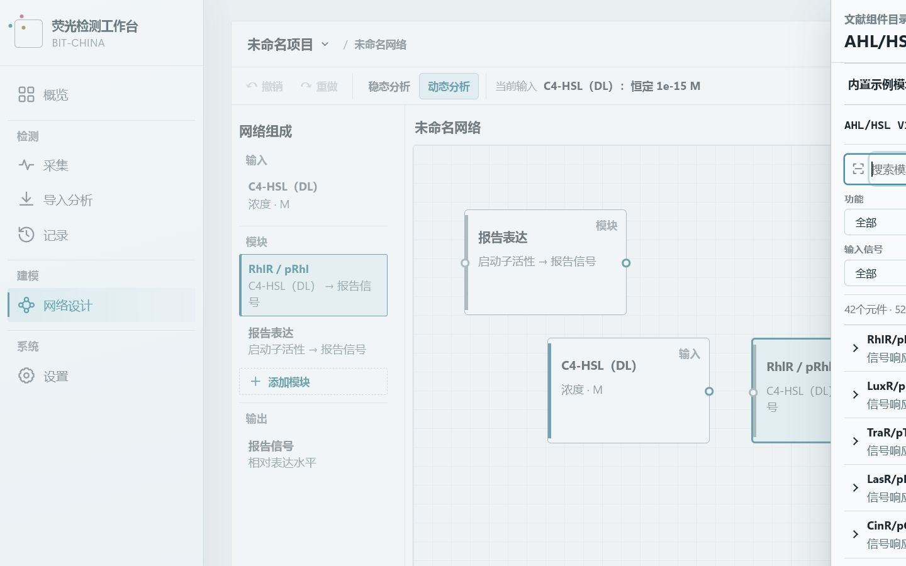
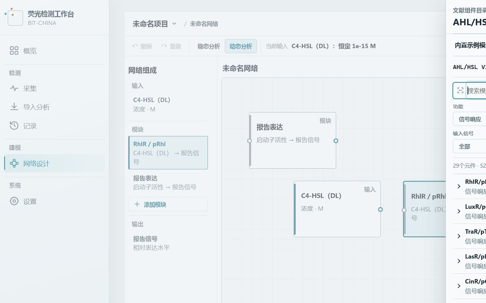
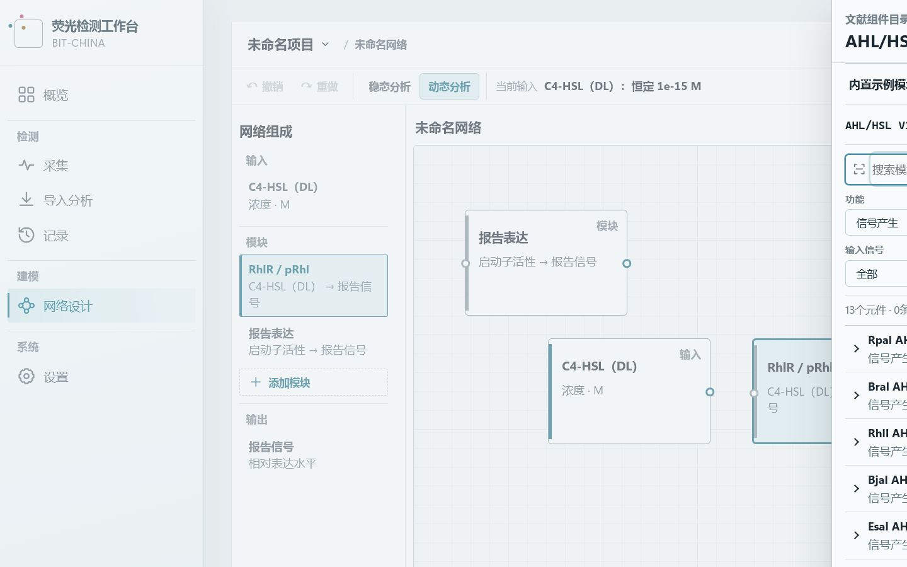
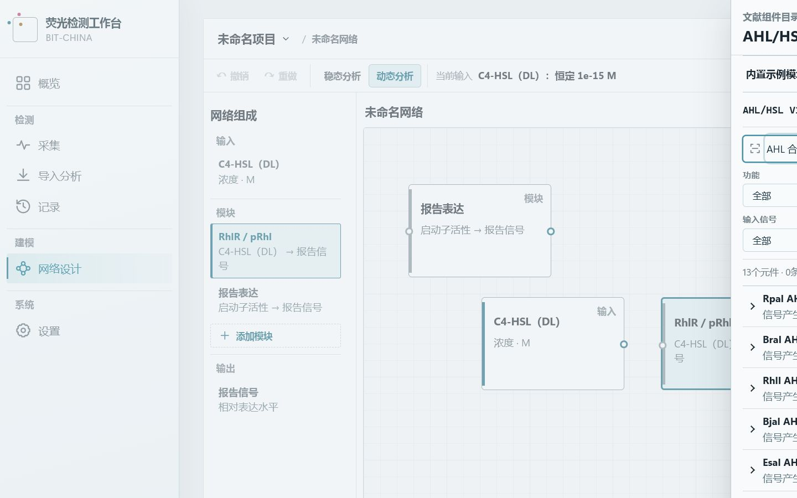
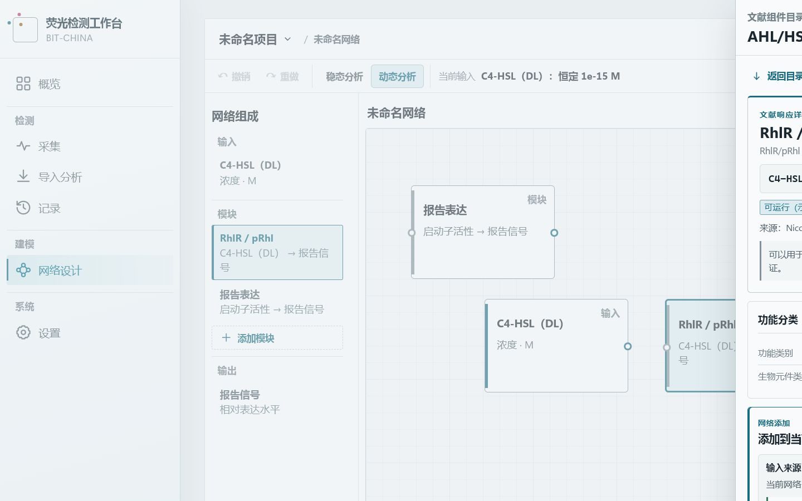
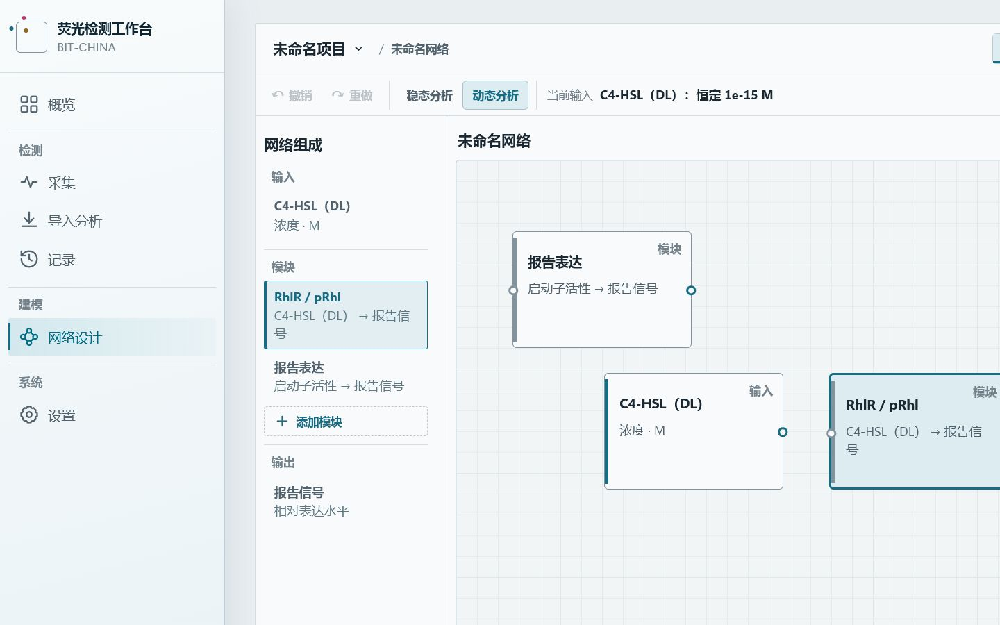
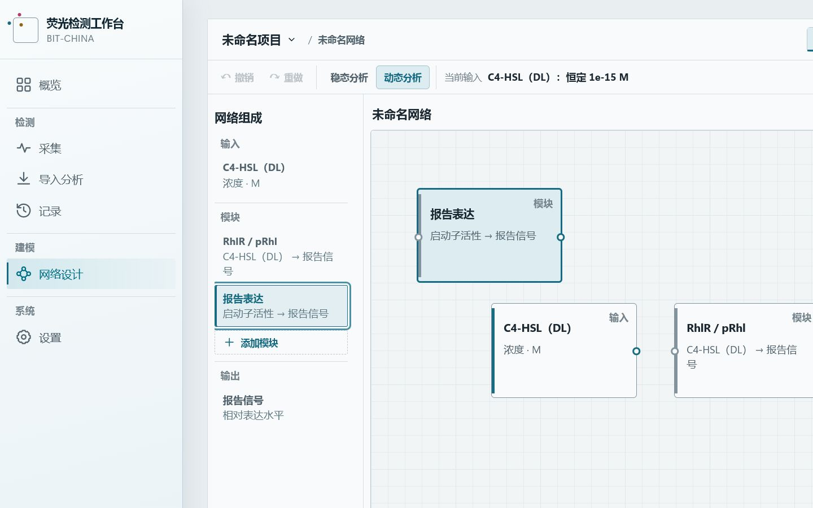
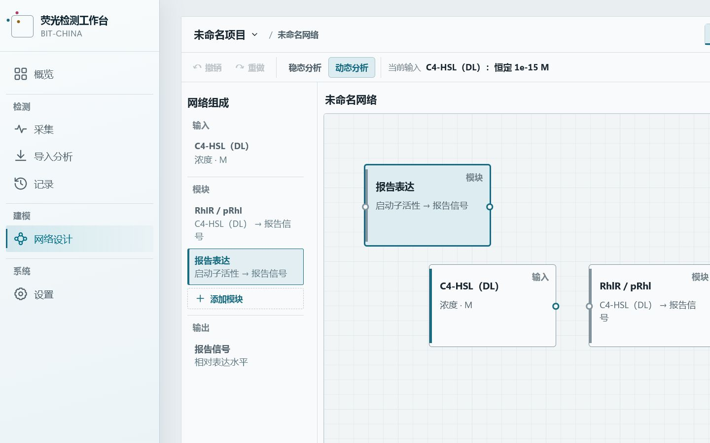
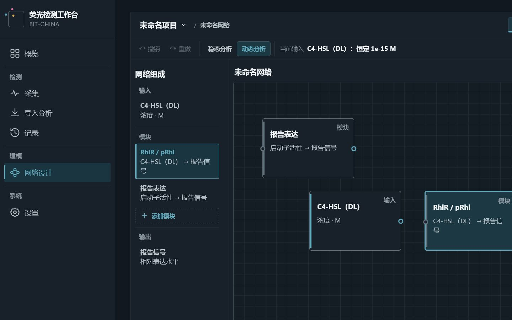

# Batch 9.2 Semantic Ontology UI Audit

审计对象为 Windows 桌面端 BIO-NET 工作流。页面通过本地 Vite 桌面预览加载真实冻结 Catalog 与当前项目状态；截图均为真实 1440×900 PNG。语义标签只承担分类展示，不改变证据、可运行资格、连接兼容或计算合同。

## Audit captures

### 01 · Catalog Function filter

- 状态：浅色主题，Catalog Discovery 默认结果。
- 检查点：Function、Status、Input Signal、Host 以 2×2 结构同时可见；Function 选项由当前语义投影生成。

### 02 · Signal response filter

- 状态：Function 选择“信号响应”。
- 检查点：只保留 receiver / response Component；功能分类没有改变 runnable、evidence 或结果计数合同。

### 03 · Signal production filter

- 状态：Function 选择“信号产生”。
- 检查点：只保留 sender Component；冻结 V1.1 sender 继续显示“暂无定量发送函数”。

### 04 · Family-aware search

- 状态：搜索“AHL 合成系统”。
- 检查点：双语 Biological Component Family 名称可发现 sender；搜索不索引 Ontology ID 或描述文本。

### 05 · Catalog Full Detail classification

- 状态：RhlR/pRhl 的 C4-HSL（DL）可运行响应 Full Detail。
- 检查点：“功能分类”独立呈现“信号响应”与“AHL 接收/调控系统”；模型、来源、实验条件与 Add Panel 继续使用原合同。

### 06 · Catalog-backed Module Inspector

- 状态：从可信 Catalog response 实例化的 RhlR / pRhl 模块。
- 检查点：Inspector 从精确 Catalog Component ID 解析语义；模块、输入源、项目签名与运行模型没有被语义展示改写。

### 07 · Built-in Reporter classification

- 状态：内置“报告表达”模块。
- 检查点：exact built-in mapping 显示“表达响应”与“报告表达系统”；功能类别、数学模型和模型依据保持分离。

### 08 · Static / dynamic separation

- 状态：Reporter 处于动态分析，数学模型区展开。
- 检查点：Functional Family 保持“表达响应”，Mathematical Model 显示“一阶动态模型”，Model Basis 保持“机制模型”。

### 09 · Dark theme

- 状态：深色主题下的 Catalog-backed RhlR / pRhl Inspector。
- 检查点：分类采用中性 property row，不使用 success / warning badge，不依赖颜色传递科学状态。

## Responsive measurements

| Viewport | Page horizontal overflow     | Catalog Drawer | Four filters | Inspector body                | Inspector scroll |
| -------- | ---------------------------- | -------------- | ------------ | ----------------------------- | ---------------- |
| 1440×900 | none; document width 1440 px | 560×900 px     | all visible  | 628 / 1123 px client / scroll | independent      |
| 1280×720 | none; document width 1280 px | 560×720 px     | all visible  | 478 / 1141 px client / scroll | independent      |
| 1180×700 | none; document width 1180 px | 560×700 px     | all visible  | 458 / 1141 px client / scroll | independent      |

Browser console audit returned 0 warnings and 0 errors across filtering, bilingual family search, Full Detail, instantiation, Inspector, dynamic mode and theme switching.
