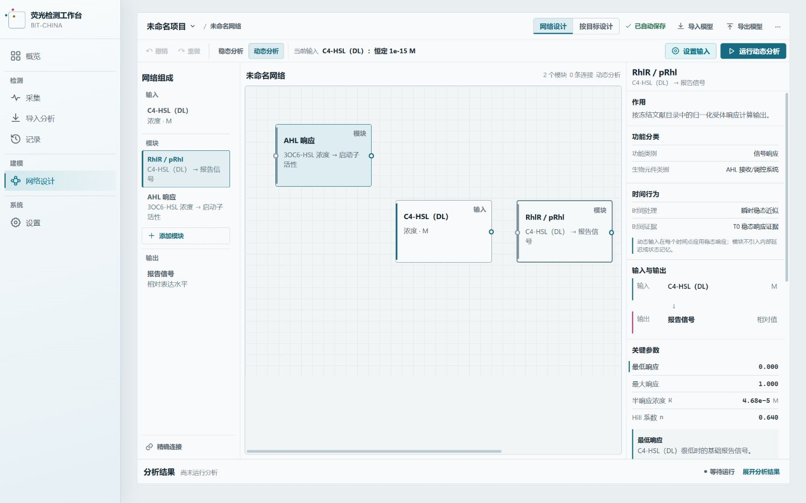
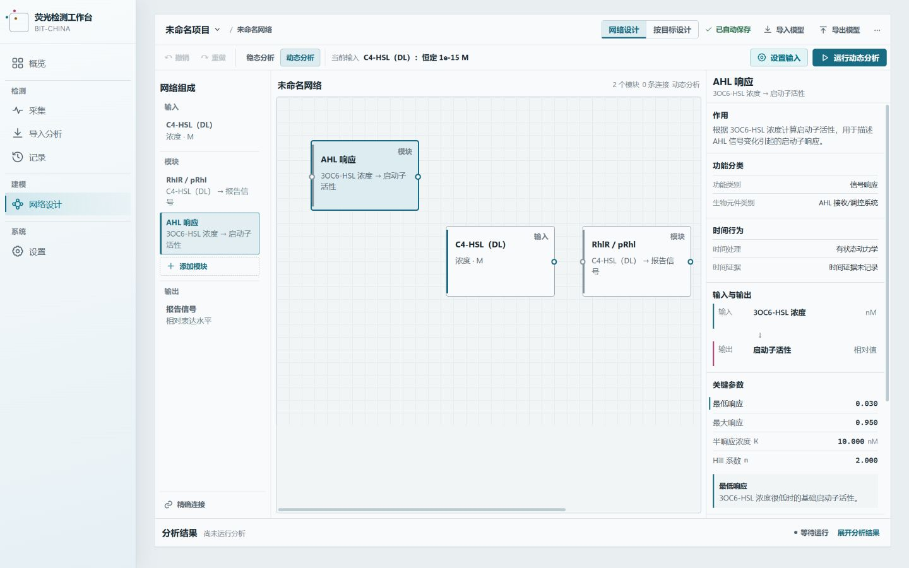
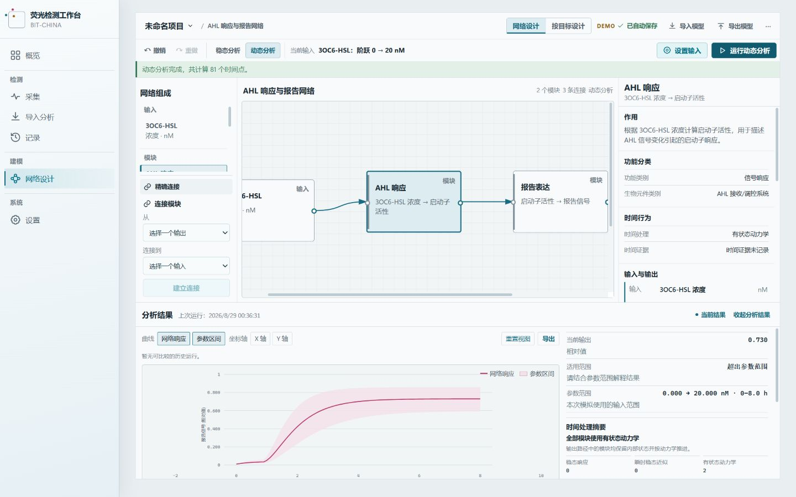
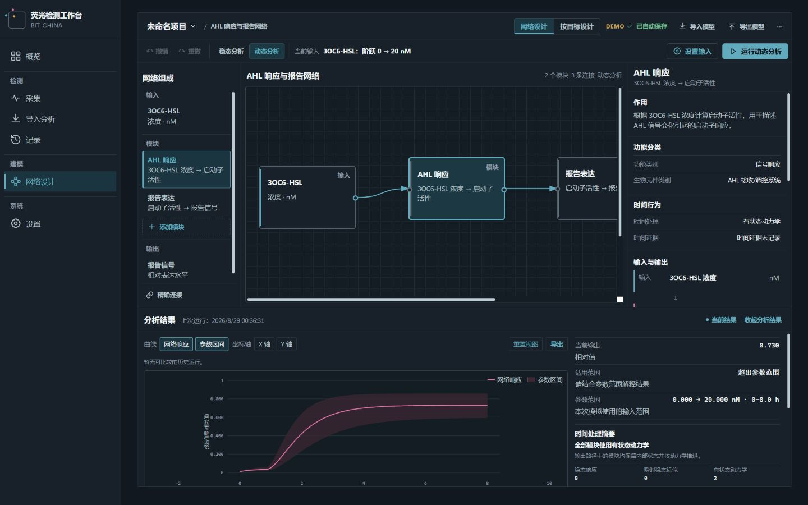

# Batch 10.1 Temporal Compatibility UI Audit

审计对象为 Windows 桌面端 BIO-NET 生产工作流。本地 Vite 预览加载真实冻结 Catalog、Built-in model 与运行结果；当前截图均为 1440×900 PNG。时间语义、端口兼容性和实验上下文只解释当前计算边界，不改变数值公式、Catalog trust、Ontology classification 或历史比较资格。

## Audit captures

### 01 · Quasi-static Module Inspector

- 状态：浅色主题，可信 Catalog RhlR / pRhl Receiver，Dynamic analysis。
- 检查点：Functional Classification 显示 signal response；Time Behavior 显示瞬时稳态近似；Temporal Evidence 显示稳态响应证据；界面明确模块没有内部延迟或状态记忆。

### 02 · Stateful Module Inspector

- 状态：浅色主题，内置 AHL response 的 first-order dynamic model。
- 检查点：Time Behavior 显示有状态动力学；Temporal Evidence 显示未记录，没有把模型依据自动升级为 T2 / T3 时间证据。

### Support · Stateful Dynamic Result

- 状态：内置 dynamic demo 完成运行并展开 Result / Provenance。
- 检查点：结果摘要、模块明细和 provenance 使用运行自身 temporal snapshot；图表与已有 dynamic metrics 保持可读。

### 06 · Dark theme

- 状态：深色主题，dynamic result 与时间处理摘要展开。
- 检查点：时间执行和证据通过文字与结构传达，不依赖颜色；Result chart、明细和边界说明保持清晰。

## Pending captures

- `03-mixed-dynamic-result-1440x900.png`：真实 mixed fixture 已生成，包含一个 stateful dynamic module 与一个 quasi-static module；浏览器扩展当前拒绝本地 BFN-IR 文件上传，待启用 file URL access 后补录。
- `04-connection-context-uncertain-1440x900.png`：真实 context-uncertain fixture 已生成；同一上传权限阻塞 Edge Inspector 截图。
- `05-unit-normalization-1440x900.png`：当前真实 UI 无法自然构造同 entity / quantity / dimension、不同单位的端口组合；依照任务要求，没有为截图新增 Demo 业务对象。

## Responsive measurements

| Viewport | Page width client / scroll | Inspector  | Inspector body client / scroll | Result panel      | Chart client / scroll | Canvas behavior                        |
| -------- | -------------------------- | ---------- | ------------------------------ | ----------------- | --------------------- | -------------------------------------- |
| 1440×900 | 1440 / 1440 px             | 291×681 px | independent vertical scroll    | visually verified | no page overflow      | internal horizontal canvas scroll only |
| 1280×720 | 1280 / 1280 px             | 269×274 px | 221 / 928 px                   | 1037×302 px       | 668 / 668 px          | no page overflow                       |
| 1180×700 | 1180 / 1180 px             | 269×262 px | 210 / 928 px                   | 941×293 px        | 626 / 626 px          | 476 / 980 px internal scroll           |

Inspector 在两个紧凑断点均使用独立纵向滚动；新增 Temporal 内容未引入页面级水平溢出。1180×700 下 Canvas 的 980 px 内容宽度限制在 476 px 内部滚动容器中，不挤压 Inspector 或 Result Panel。

应用页面控制台审计返回 0 warnings、0 errors。浏览器控制插件自身访问 `ab.chatgpt.com` 的 Statsig timeout 属于工具遥测，不来自应用页面，未计入产品日志。
